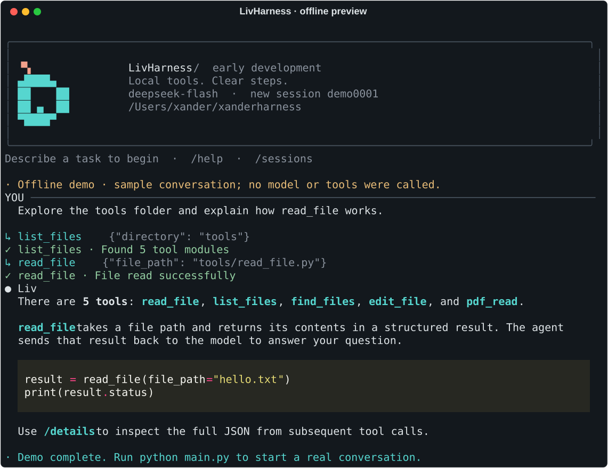

# LivHarness

[English](README.md) | [简体中文](README_ZH.md)

**An experimental agent harness working toward completion reports backed by checks and evidence.**

LivHarness is a small Python project that connects a language model to tools and manages how it carries out a task.

> **Early development · v0.2 core features complete, not yet released.** Streaming, file tools, structured tool results, and saved conversations work today. We are starting v0.3: recording what was actually checked, what failed, and what remains unknown. Verification is not implemented yet.

## What We Want to Build

### 1. Make completion claims checkable — Verified Agent Execution

An agent saying “done” is not enough. We want the harness to record the requirements, run checks against the actual result, and show the evidence behind each verification status.

For example, if the user asks to change a port to `8080` without changing other settings, checking the port alone is insufficient. The harness should also compare the remaining settings and report any unintended change.

The system cannot automatically know the correct standard for every task. Each check needs an explicit scope and source. A model may suggest a check, but its suggestion is not automatically a user requirement or proof of success. When evidence is missing, the result should remain unverified.

### 2. Stay on track during long tasks — State-Aware Context Engineering

Give the model the latest goal, important constraints, unresolved problems, and changes to files or the environment on each call.

For example, when the user changes a requirement, the agent should follow the new request. A long conversation should not make it forget “do not modify this folder.” If a file changes, it should recognize that its earlier reading may be out of date.

We want to select information for the next step based on task progress, reducing unnecessary history while preserving details that affect future actions.

We will start with local file tasks and test whether these ideas lead to more successful tasks, fewer repeated actions, and reasonable costs.

## Features

The current prototype can:

- Chat with DeepSeek and call tools.
- Read text, list directories, and find files.
- Edit a file by replacing a unique text match.
- Extract text from PDFs using `pypdf` (no OCR or image understanding).
- Save conversations, load previous sessions, and list recent sessions.
- Read answers as they arrive in a scrolling terminal interface, with Markdown formatting, tool status, editable input, and session commands.
- Inspect structured tool results, stop a turn with Ctrl+C, and retain recorded progress at the 10-request limit.

Verified Agent Execution and State-Aware Context Engineering are still planned. A successful tool result is not independent verification that the whole task is complete. Session loading restores saved messages, not the exact state of an interrupted task.

## Roadmap

Each version has a concrete set of features to deliver. These are development targets, not published releases; dates are not set yet.

| Version | Focus | Planned features | Status |
| --- | --- | --- | --- |
| **v0.1** | Basic harness | Model calls, tool registration and execution, file tools, conversation history, session saving and loading | Core features implemented |
| **v0.2** | Terminal interface and tool results | A scrolling TUI with streaming answers, Markdown, tool logs, session selection, and interruption handling; structured results with success/failure, content, and error details | Core features complete; not yet released |
| **v0.3** | Evidence for completion | Record requirements and their sources; run checks on local file results; tie evidence to artifact versions; separate system verification reports from model replies | Current development target; design defined, implementation pending |
| **v0.4** | Stay on track | Follow updated goals, preserve constraints and unresolved errors, refresh outdated file information, and reduce unnecessary history | Planned |
| **v1.0** | Bring it together | Combine the interface, tools, verification, and context management for local tasks; add repeatable evaluations and document supported behavior | Planned |

The v0.2 milestone is complete. Our current focus is the v0.3 scope below; v0.4 remains focused on context management. Reliable crash recovery is a later improvement, to be scoped when long tasks such as batch processing need it.

## v0.3: What We Will Build First

**Goal:** Check registered requirements with a recorded basis, and produce a system report limited to what the evidence supports. This is a development plan, not a description of current features.

We will start with local file and configuration edits. For the first experiments, criteria will be specified in advance by the user or task author. Automatic discovery of criteria is a later research step.

| Record | What it keeps |
| --- | --- |
| Task | The original request and subsequent changes |
| Criterion | What to check, its source, and whether it has been accepted for this task |
| Check record | The check that ran, its observations, and the versions of the criterion and relevant files |
| System report | Which checks passed, failed, or remain unverified, with links to their evidence |

The first implementation must follow these rules:

- **Keep requirements traceable.** Preserve the original request and changes. A model must not silently delete a requirement or label its own proposal as user-approved. A real source does not guarantee that its interpretation is correct; ambiguity remains explicit until resolved.
- **Run checks through the harness.** Check records come from actual checker executions. A tool's success flag or a model-written `passed` value is not verification evidence.
- **Keep evidence current.** Bind results to the checked criteria and files. If either changes, require a new check. A file fingerprint detects changes; it does not prove that a criterion is correct or capture the whole environment.
- **Separate reporting from generation.** Use program rules to produce the system report, displayed separately from the model's streamed reply. Passing all registered checks only establishes that checked scope, not that every possible requirement was discovered or met.

The first milestone is a configuration-edit task with four acceptance cases:

1. The requested value changes and other settings remain unchanged: checks pass.
2. The tool reports success but leaves the file unchanged: the result fails the check.
3. The requested value changes, but unrelated settings also change: the preservation check fails.
4. The file changes after a successful check: the old result no longer verifies the current file.

Missing checks, unreadable files, and unresolved criteria must remain unverified with a reason. Start with ordinary Python modules and deterministic file checks; multiple verifier agents are not required for this milestone.

## Research After the First Verification Loop

We want to investigate how a harness can discover useful candidate criteria from task context, tests, and documentation; search for counterexamples; and choose worthwhile checks within a budget. These are experiments without committed version numbers or proven gains. They build on the verification records above and the context work planned for v0.4.

Related work includes [VeriHarness](https://arxiv.org/abs/2610.00972), [LLM-generated test oracles](https://arxiv.org/abs/2607.10277), and [LEDGER](https://arxiv.org/abs/2608.18398). Our proposed combination is a research direction, not an established originality or performance claim.

We plan to compare a basic agent loop, fixed checks, and later adaptive checks using the same tasks, model, and comparable budgets. Evaluation should use independently prepared criteria unavailable to the agent, and measure actual task success, incorrect completion claims, missed valid completions, unresolved outcomes, and time/token cost. Always reporting “unknown” must not count as success. There are no benchmark results yet.

## Changelog

**[Read the changelog →](CHANGELOG.md)**

See what has actually been added or changed. Work that has not been released is listed under **Unreleased**; future plans belong in the roadmap above.

## Quick Start

You need Git, Python 3.10+, and a DeepSeek API key with access to the configured model.

```bash
git clone https://github.com/Xander-26Code/livharness.git
cd livharness
python -m venv .venv
source .venv/bin/activate
python -m pip install -r requirements.txt
```

Use your Python 3.10+ interpreter if its command differs from `python`. On Windows PowerShell, activate with `.venv\Scripts\Activate.ps1`.

### Configuration

Create a `.env` file in the project root:

```dotenv
DEEPSEEK_API_KEY=replace_with_your_own_key
```

The model is currently set to `deepseek-flash`. The model and API endpoint can be changed in [agent_loop.py](agent_loop.py). Keep your key out of commits; `.env` is already ignored by Git.

Run from the repository root:

```bash
python main.py
```

Try: `Read tools/read_file.py and explain what it does.`

**Use test files or copies.** The prototype edits files directly and has no sandbox or automatic rollback. File contents may be sent to the model provider, and model requests use your API account.

## Usage

| Command or input | What it does |
| --- | --- |
| `python main.py` | Start a new conversation in the terminal UI |
| `python main.py --demo` | Preview the UI offline, with no API calls or session writes |
| `python main.py --plain` | Use basic input without colors or animations |
| `python main.py --list-sessions` | List saved conversations, newest first |
| `python main.py --resume SESSION_ID` | Load a conversation; replace `SESSION_ID` with its actual ID |
| `/help` | Show commands and keyboard shortcuts |
| `/new` | Start a new session without deleting the previous one |
| `/sessions` or `/resume` | List sessions with conversation titles and selection numbers |
| `/resume NUMBER` or `/resume ID` | Resume from the last displayed list, or use a full session ID |
| `/session` | Show the current full session ID |
| `/details` | Toggle full JSON for subsequent tool results |
| `/clear` | Clear the current conversation; file changes remain |
| `/exit`, `exit`, or `quit` | Save and exit |

The interface is in English; conversation content keeps its original language. Type commands at the `❯` prompt. Enter sends; Ctrl+J (or Esc then Enter) inserts a newline; arrow keys browse input history; Tab completes commands. Ctrl+C cancels input or stops the running turn. Stopping does not undo file changes, and a tool with no recorded result must be checked before retrying.

Answers appear as text arrives, including in `--plain` mode. Thinking mode is currently enabled: there may be a wait before answer text starts, and reasoning text is not displayed. In the regular TUI, long answers preview their latest lines while streaming; the complete Markdown answer remains in scrollback afterward. If generation stops early, visible partial text is marked incomplete and is not saved as a completed assistant reply.

Only model requests require an API key. Help, the demo, and session commands work offline. The UI lives in [tui/](tui/); it receives responses and progress through callbacks from the agent loop.



*English UI rendered from the offline demo; example content, no model calls. Regenerate with `python scripts/render_tui_preview.py`.*

## Contributing

Help us build one small, working improvement at a time:

- **Getting started:** Improve documentation, report a reproducible bug, or add a file-tool test.
- **Terminal experience:** Test streaming, long answers, and interruption in different terminals; improve tool-result presentation.
- **v0.3 — Checking work:** Build criterion and evidence records, file checkers, and the four acceptance cases above; help present verification separately from model replies.
- **Context:** Create cases where the agent must follow a new requirement, remember a constraint, or notice a changed file.

The current suite has 21 automated tests covering editing, sessions, invalid tool-call JSON, the model-call limit, streaming text and tool parameters, truncated responses, and TUI input, display, and interruption. After installing the project dependencies, run them from the repository root; no API key or real model calls are needed:

```bash
python -m unittest discover -s tests -v
```

Broader tool and session tests, along with CI, are still needed. The code starts in [main.py](main.py), the agent loop is in [agent_loop.py](agent_loop.py), and tools live in [tools/](tools/).

Open an [Issue](https://github.com/Xander-26Code/livharness/issues) to discuss an idea, or read the [contribution guide (Chinese)](CONTRIBUTING.md) for the development and PR workflow. English and Chinese contributions are welcome, including from beginners.

## License

A project license has not been selected yet. The repository currently has no `LICENSE` file.
