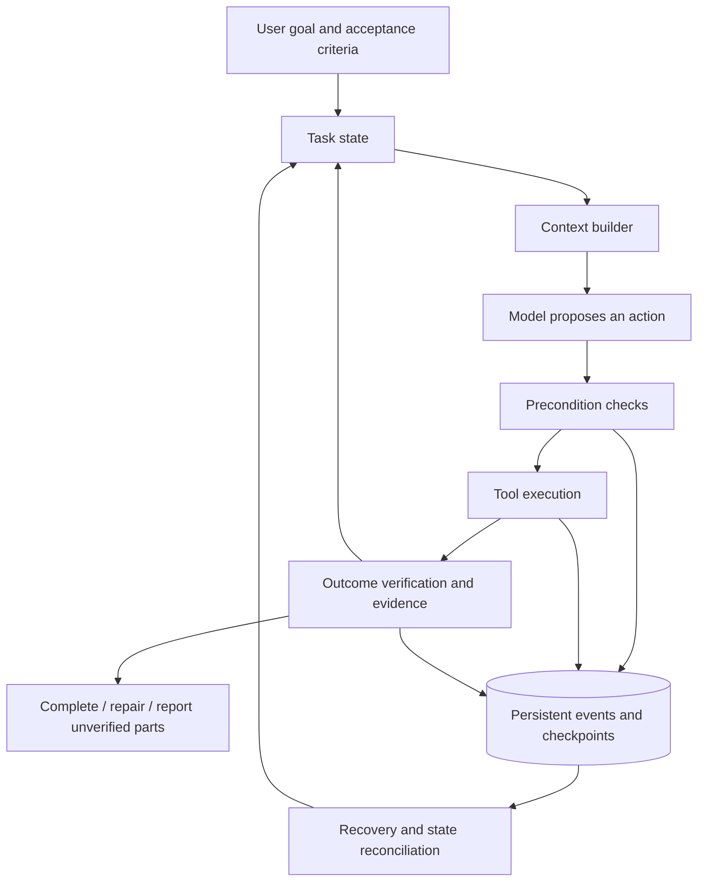

# LivHarness

[English](README.md) | [简体中文](README_ZH.md)

A Python agent harness exploring **verified execution, durable state, and state-aware context**, starting from a minimal agent loop.

> **Status: Pre-alpha / early development.** The current implementation is a single-agent CLI prototype with basic file tools and conversation persistence. The three core capabilities below are development goals and are not yet fully implemented. There are no formal releases or benchmark results demonstrating a performance advantage.

We want agents to complete real tasks more reliably, with inspectable evidence behind completion claims, recovery decisions, and context selection. Contributions to design, implementation, failure cases, and evaluation are welcome. Help us turn this prototype into a project whose design choices can be tested.

[Quick Start](#quick-start) · [Features](#features) · [Research Directions](#research-directions) · [Roadmap](#roadmap) · [Contributing](#contributing)

## Overview

A basic agent loop lets a model choose tools, observe results, and respond. As tasks grow longer, three questions become increasingly important:

1. When the model says a change succeeded, what did the system actually check? Does that evidence still apply to the current files?
2. If the process crashes after writing a file but before recording the outcome, should it continue, retry, or reconcile the actual state first?
3. As history grows, which goals, constraints, errors, and environment changes should the next model call receive?

LivHarness explores these questions in that order. We will start with local file tasks that have a clear scope and checkable outcomes, validate designs through reproducible cases, and expand gradually. Existing techniques provide a foundation; experiments will determine whether our implementation helps.

## Features

| Capability | Current implementation |
| --- | --- |
| Conversation and tool loop | Calls DeepSeek through the OpenAI Python SDK, with up to 10 model calls per user input |
| Tool registration | Tool schemas and function mappings are maintained in `tools/__init__.py` |
| File operations | Read text, list directories, find files recursively, and replace a unique text match in a file |
| PDF text extraction | Uses `pypdf` to extract and combine text from all pages; no OCR or image understanding, and table structure is not guaranteed |
| Session management | Generates random session IDs, saves and loads JSON conversations, and lists sessions by most recent update |
| Basic error feedback | Returns some argument, file access, and editing errors to the model as tool results |

Independent task verification, action-level crash recovery, a context builder, an automated test suite, and CI are not yet available. `--resume` loads saved conversations; it does not guarantee recovery of interrupted execution state.

## Quick Start

### Prerequisites

- Python 3.10 or later. The source uses syntax such as `str | None`; a full Python version compatibility matrix has not been tested.
- A DeepSeek API key with access to the configured model.
- Git and network access to install the dependencies in [requirements.txt](requirements.txt).

The commands below use a macOS / Linux shell. First check that `python --version` is at least 3.10. If your interpreter is named `python3.12`, for example, use that command when creating the virtual environment.

```bash
git clone https://github.com/Xander-26Code/livharness.git
cd livharness
python -m venv .venv
source .venv/bin/activate
python -m pip install -r requirements.txt
```

On Windows PowerShell, activate the virtual environment with `.venv\Scripts\Activate.ps1`.

### Configuration

Create a `.env` file in the project root and add your own key:

```dotenv
DEEPSEEK_API_KEY=replace_with_your_own_key
```

| Setting | Current behavior |
| --- | --- |
| `DEEPSEEK_API_KEY` | Required; read from the root `.env` file or the process environment |
| API endpoint | Set to `https://api.deepseek.com` in `agent_loop.py` |
| Model | Set to `deepseek-flash` in `agent_loop.py` |
| Thinking | Set to `disabled` in the current request |

The model and endpoint do not yet have CLI flags or environment-variable overrides. To change them, edit [agent_loop.py](agent_loop.py). The model name above reflects the current source configuration; availability depends on the provider and your account.

Values in `.env` currently override process environment variables with the same name. Keep keys out of source code, Issues, and commits. [.gitignore](.gitignore) already excludes `.env` and the local session directory.

### Run

Run from the repository root. Relative tool paths and the `sessions/` directory are resolved against the current working directory.

```bash
python main.py
```

The CLI displays a `Session ID` and a `User:` prompt. Try:

```text
What files and folders are in the current directory?
Read tools/read_file.py and explain what it does.
Find all *.py files under the tools directory.
```

Model requests use your API account. File contents returned by tools enter the conversation and may be sent to the model provider. Tools currently run with the local process's file permissions, without a sandbox or workspace boundary. Edits write directly to files, with no confirmation step or automatic rollback. Use test files or copies when trying the prototype.

## Usage

| Command or input | Behavior |
| --- | --- |
| `python main.py` | Start a new session |
| `python main.py --list-sessions` | List saved sessions, most recently updated first |
| `python main.py --resume SESSION_ID` | Load a session's message history; replace `SESSION_ID` with an actual ID |
| `python main.py --help` | Show CLI arguments |
| Enter `/clear` at `User:` | Clear and save the current conversation while retaining the system message; this does not undo file operations |
| Enter `exit` or `quit` at `User:` | Exit the program |

The entry point currently initializes the model client before parsing CLI arguments, so `--help` and `--list-sessions` also require installed dependencies and a configured `DEEPSEEK_API_KEY`. These commands do not send model requests.

Sessions are stored in `sessions/<session_id>_messages.json`. Messages are currently saved only after each user task returns. File changes and conversation persistence are not part of a shared transaction.

## Research Directions

### Priority 1: Verified Agent Execution

**Goal: Give each important action checkable preconditions and outcome evidence, distinguishing a model's success claim from a system-verified result.**

Starting with file editing, we will explore:

- Checking file existence, whether an edit is based on the current version, and whether the target text matches expectations before execution.
- Returning structured status, errors, affected resources, and execution records from tools, gradually replacing string-prefix error detection.
- Running independent checks against explicit task requirements, such as whether JSON parses or a field has the requested value.
- Recording the scope, rules, and file versions associated with each check, and invalidating evidence when relevant inputs change.
- Distinguishing execution success, verification passed, verification failed, and unverified outcomes, without treating a partial check as proof of full task completion.

For example, “the write completed without an error” and “the configuration now satisfies the user's requirement” should be recorded separately. A check supports conclusions only within its coverage, and the executing model must not be free to weaken acceptance criteria.

### Priority 2: Durable Agent State

**Goal: Recover from interruptions using actual execution state, while handling duplicate execution and consistency across long tasks.**

We will explore action identifiers, persistent event records, checkpoints, and recovery protocols. State should be recorded around side effects, with explicit distinctions between pending, running, succeeded, failed, and uncertain outcomes.

For example, after a crash following a successful file write, recovery should reconcile the file with the action record before deciding to skip, continue, or repair. Tools that support idempotency can have retry protocols; actions with uncertain outcomes need reconciliation. Reloading chat history is not sufficient grounds for blindly replaying actions, and we do not promise exactly-once execution for arbitrary external operations.

### Priority 3: State-Aware Context Engineering

**Goal: Build context for the next model call from task state while controlling token cost.**

We will explore separating raw events, structured task state, and the context sent to the model. A context builder should prioritize the current goal, active constraints, key decisions, unresolved errors, and environment changes, while marking stale results.

For example, if a file changes after it was read, the next turn should prompt the model to refresh the relevant content. Resolved issues can be shortened, but unresolved failures should not disappear during history compression. Token limits remain a budget constraint; task state should also guide what information is retained.

The following diagram shows the **target architecture, which is not yet implemented**:



## Roadmap

These version numbers are **proposed development milestones**, not published releases or committed release dates. The project is currently building toward the v0.1 prototype milestone. Scope discussions are welcome through Issues; we aim to complete small, verifiable steps before adding abstractions.

| Target version | Focus | Completion criteria |
| --- | --- | --- |
| **v0.1 — Foundation** | Consolidate the current loop, tools, and sessions | New contributors can start from the documentation; basic regression tests cover tool errors and session persistence without a live API |
| **v0.2 — Verified Execution** | Structured tool results, preconditions, independent checks, and evidence records | Local file cases distinguish execution success from task acceptance; cover wrong targets, failed checks, unverified outcomes, and stale evidence |
| **v0.3 — Durable State** | Action-level state, persistent events, recovery, and duplicate execution handling | Inject interruptions before execution, after execution but before recording, and after recording; correctly identify completed, failed, and uncertain actions during recovery |
| **v0.4 — State-Aware Context** | Build context dynamically from task state | Preserve essential constraints and unresolved errors in long tasks; detect environment changes; compare outcomes and token usage against full-history and fixed-summary strategies |
| **v1.0 — Integrated, Evaluable Workflow** | Combine the three capabilities, stabilize formats and interfaces, and make experiments reproducible | Provide end-to-end cases, regression tests, and evaluation commands; document supported scope, failure boundaries, and state-format migration |

The initial v1.0 scope is limited to validated local tasks. Broader tools, model integrations, and multi-agent collaboration need concrete use cases and evaluation support; they are not prerequisites for the current milestones.

## Evaluation Plan

Evaluation infrastructure has yet to be built. We plan to compare the basic loop with versions that enable new mechanisms, holding the model, tasks, tools, and budget constant. Context strategies and recovery mechanisms will be evaluated separately so that the effects of multiple changes are not conflated.

We will prioritize reproducible cases such as:

| Scenario | What to check |
| --- | --- |
| A tool reports success but edits the wrong target | Whether unmet task requirements are detected |
| A file changes after verification passes | Whether stale evidence is recognized |
| The process stops after a file write but before state persistence | Whether recovery reconciles the outcome and avoids unnecessary duplicate side effects |
| An early constraint remains relevant in a long conversation | Whether subsequent actions still satisfy it |
| The environment changes during a task | Whether relevant state and context are refreshed |

Track actual task success, false completion reports, recovery outcomes, duplicate side effects, elapsed time, and token usage. An independent evaluator should inspect the final state rather than score the agent's own completion statement. Report task quality alongside any speed improvement.

## Project Structure

```text
livharness/
├── main.py              # CLI, user input, session selection and persistence
├── agent_loop.py        # Model calls and the tool execution loop
├── session.py           # JSON session I/O and sorting by update time
├── tools/
│   ├── __init__.py      # Tool schemas and function registration
│   ├── read_file.py     # Read text files
│   ├── list_file.py     # List files and directories; tool name: list_files
│   ├── find_files.py    # Recursive file matching, up to 100 results
│   ├── edit_file.py     # Replace a unique text match
│   └── pdf_read.py      # Extract PDF text
├── requirements.txt    # Python dependencies
├── README.md           # English README (default)
├── README_ZH.md        # Chinese README
└── CONTRIBUTING.md     # Contribution workflow, checks, and starting points
```

`.env`, virtual environments, and `sessions/` are local configuration or runtime data and are not distributed with the repository.

## Testing

There is currently no automated test suite or CI. After installing dependencies and configuring a key, you can check the CLI entry point and conversation flow:

```bash
python main.py --help
python main.py
```

A working help command does not establish that the model service or task execution works. Good first contributions include tool tests without model calls, file-operation tests in temporary directories, and session regression tests. Manual check steps are available in the [contribution guide (Chinese)](CONTRIBUTING.md#验证改动).

## Contributing

We welcome Python developers, agent developers, contributors interested in testing and system reliability, and people who are just getting started.

- **First contributions:** Improve setup instructions, provide minimal bug reproductions, or add focused regression tests for file tools.
- **Execution and verification:** Design structured tool results, preconditions, acceptance checks, and evidence invalidation cases.
- **State and recovery:** Work on event formats, recovery protocols, interruption injection, and duplicate execution detection.
- **Context and evaluation:** Build long-task cases, compare context strategies, and measure correctness and cost.

Start with a clear failure case and discuss a solution. You do not need to implement an entire subsystem at once. Pick a focused problem, include reproducible results, and submit a small PR.

Read [CONTRIBUTING.md (currently in Chinese)](CONTRIBUTING.md), or start a discussion in [Issues](https://github.com/Xander-26Code/livharness/issues). Contributions and discussions in English or Chinese are welcome. The roadmap describes areas of work, not a list of already assigned tasks. Before starting a substantial change, explain the problem you intend to solve.

## License

TODO: Choose and add a project license. The repository currently has no `LICENSE` file; this document does not declare MIT, Apache-2.0, or other licensing terms. The contribution guide will be updated when the license is decided.
