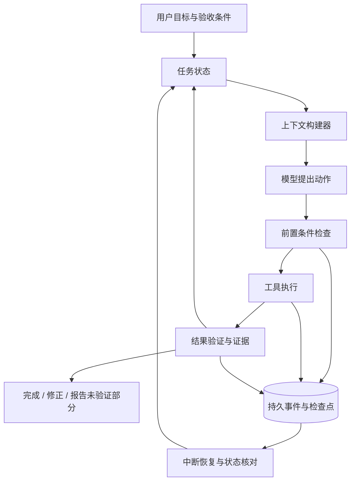

# LivHarness

[简体中文](README.md) | [English](README_EN.md)

一个从最小 Agent Loop 出发，探索**可验证执行、持久状态和状态感知上下文**的 Python Agent Harness。

> **开发状态：Pre-alpha / 初级开发阶段。** 当前可运行的是单 Agent 命令行原型，支持基础文件工具和对话保存。下文的三项核心能力是开发目标，尚未完整实现；目前没有正式版本发布，也没有性能领先的评测结论。

我们希望让 Agent 更可靠地完成真实任务，并让每一次“完成”、中断恢复和上下文取舍都有可检查的依据。欢迎参与设计、实现、失败案例收集和评测，一起把这个原型做成可以验证设计价值的项目。

[快速开始](#快速开始) · [当前功能](#当前功能) · [研究方向](#研究方向) · [版本路线图](#版本路线图) · [贡献指南](CONTRIBUTING.md)

## 为什么做这个项目

一个基础 Agent Loop 可以让模型选择工具、观察结果、继续回答。随着任务变长，还需要回答三个问题：

1. 模型说“修改成功”时，系统实际检查了什么？检查结果还适用于当前文件吗？
2. 文件已经写入、执行记录还没保存时进程崩溃，重启后应该继续、重试，还是先核对状态？
3. 历史越来越长时，下一次调用应该保留哪些目标、约束、错误和环境变化？

LivHarness 按这个顺序推进研究。我们会先支持范围明确、结果可检查的本地文件任务，用可复现案例检验设计，再逐步扩大能力范围。已有技术可以作为基础；是否有效，需要靠实验回答。

## 当前功能

| 能力 | 当前实现 |
| --- | --- |
| 对话与工具循环 | 使用 OpenAI Python SDK 调用 DeepSeek；每条用户输入最多进行 10 轮模型调用 |
| 工具注册 | 在 `tools/__init__.py` 中维护工具描述和函数映射 |
| 文件操作 | 读取文本、列出目录、递归查找文件、替换文件中的唯一匹配文本 |
| PDF 文字提取 | 使用 `pypdf` 读取所有页面并合并文字；不支持 OCR、图片理解，不保证保留表格结构 |
| 会话管理 | 新建随机会话 ID、保存和恢复 JSON 对话、按最近更新时间列出会话 |
| 基础错误反馈 | 部分参数、文件访问和编辑错误会作为工具结果反馈给模型 |

当前尚无独立任务验收、动作级崩溃恢复、上下文构建器、自动化测试套件或 CI。`--resume` 读取的是已保存的对话，不能保证恢复中断时的执行状态。

## 快速开始

### 环境要求

- Python 3.10 或更高版本：源码使用了 `str | None` 等语法。目前尚无完整版本兼容性测试矩阵。
- 一个能够访问当前配置模型的 DeepSeek API Key。
- Git，以及安装 [requirements.txt](requirements.txt) 中依赖的网络环境。

以下命令使用 macOS / Linux shell。请先确认 `python --version` 至少为 3.10；如果你的解释器命令是 `python3.12` 等，请替换创建虚拟环境时的 `python`。

```bash
git clone https://github.com/Xander-26Code/livharness.git
cd livharness
python -m venv .venv
source .venv/bin/activate
python -m pip install -r requirements.txt
```

Windows PowerShell 用户可使用 `.venv\Scripts\Activate.ps1` 激活虚拟环境。

### 配置

在项目根目录手动创建 `.env` 文件，填入自己的密钥：

```dotenv
DEEPSEEK_API_KEY=replace_with_your_own_key
```

| 配置项 | 当前行为 |
| --- | --- |
| `DEEPSEEK_API_KEY` | 必需；从根目录 `.env` 或进程环境读取 |
| API 地址 | 在 `agent_loop.py` 中配置为 `https://api.deepseek.com` |
| 模型 | 在 `agent_loop.py` 中配置为 `deepseek-flash` |
| Thinking | 当前请求中设为 `disabled` |

模型和 API 地址目前没有对应的 CLI 参数或环境变量开关；如需调整，请编辑 [agent_loop.py](agent_loop.py)。上述模型名记录的是当前源码配置，可用性取决于服务端和账户。

当前 `.env` 中的同名变量会覆盖进程环境变量。密钥不要写进代码、Issue 或提交记录；[.gitignore](.gitignore) 已忽略 `.env` 和本地会话目录。

### 启动

请在仓库根目录执行，工具的相对路径和 `sessions/` 都以当前工作目录为基准。

```bash
python main.py
```

启动后会显示 `Session ID` 和 `User:` 提示。可以输入：

```text
当前目录有哪些文件和文件夹？
请读取 tools/read_file.py，解释它做了什么。
在 tools 目录中查找所有 *.py 文件。
```

运行模型请求会使用你的 API 账户。工具读取的文件内容会进入对话并可能发送给模型服务。当前工具使用本机进程权限访问文件，没有沙箱或工作目录边界限制；编辑会直接写入文件，没有确认步骤或自动回滚。请在测试文件或副本上试用。

## 使用方式

| 命令或输入 | 作用 |
| --- | --- |
| `python main.py` | 开始新会话 |
| `python main.py --list-sessions` | 按最近更新时间列出已保存会话 |
| `python main.py --resume SESSION_ID` | 读取指定会话的历史消息；替换 `SESSION_ID` 为实际 ID |
| `python main.py --help` | 查看命令行参数 |
| 在 `User:` 后输入 `/clear` | 清空当前会话的对话，保留系统消息并保存；不撤销已执行的文件操作 |
| 在 `User:` 后输入 `exit` 或 `quit` | 退出程序 |

当前入口会在解析命令行参数前初始化模型客户端，因此 `--help` 和 `--list-sessions` 也需要安装依赖并配置 `DEEPSEEK_API_KEY`。它们本身不会发送模型请求。

会话保存在 `sessions/<session_id>_messages.json`。目前每轮用户任务返回后才保存消息，文件写入与消息保存之间没有事务保障。

## 研究方向

### 第一优先：Verified Agent Execution

**目标：让每一步重要动作都有可检查的前置条件和结果证据，区分“模型认为成功”和“系统检查通过”。**

从文件编辑开始，探索以下机制：

- 执行前检查文件是否存在、修改是否基于当前版本、目标文本是否符合预期。
- 工具返回结构化状态、错误、受影响资源和执行记录，逐步替代字符串前缀判断。
- 根据任务的明确要求执行独立检查，例如 JSON 是否可解析、指定字段是否达到目标值。
- 记录检查的范围、规则和文件版本；相关内容变化后，使旧证据失效。
- 区分执行成功、检查通过、检查失败和未验证，避免把局部通过扩大为整个任务完成。

例如，“写入没有报错”和“配置值已经符合用户要求”应分别记录。检查只能支持其覆盖范围内的结论；验收规则也不能由执行任务的模型随意降低。

### 第二优先：Durable Agent State

**目标：让 Agent 在中断后基于真实执行状态恢复，处理重复执行和长任务状态一致性。**

重点研究动作标识、持久事件记录、检查点和恢复协议。在副作用发生前后记录状态，并明确区分待执行、执行中、成功、失败和结果不确定。

例如，文件写入成功后进程崩溃，恢复时应核对文件与动作记录，再决定跳过、继续或修复。对支持幂等的工具设计可重试协议；对无法确认结果的动作，进入核对流程。不能仅凭重新读取聊天记录就盲目重放，也不承诺任意外部操作都能做到 exactly-once。

### 第三优先：State-Aware Context Engineering

**目标：根据任务状态构建下一次模型调用的上下文，同时控制 token 成本。**

探索分离原始事件、结构化任务状态和发送给模型的上下文。上下文构建器优先保留当前目标、有效约束、关键决策、未解决错误及环境变化，并标记过期结果。

例如，文件在上次读取后发生变化时，下一轮应该提醒模型重新获取相关内容；已经解决的问题可以缩短，但尚未处理的失败不能因历史压缩而消失。token 阈值仍是预算约束，内容取舍还应依据当前任务状态。

以下是**目标架构示意，尚未实现**：



## 版本路线图

以下版本号是**拟定的开发里程碑**，不代表已经发布，也没有承诺发布日期。当前处于 v0.1 的原型建设阶段。欢迎通过 Issue 讨论范围，先完成可验收的小步，再增加抽象。

| 版本目标 | 重点 | 达成条件 |
| --- | --- | --- |
| **v0.1 — 基础原型** | 整理现有主循环、工具和会话能力 | 新贡献者能按文档启动；建立不依赖真实 API 的基础回归测试，覆盖工具错误和会话保存恢复 |
| **v0.2 — Verified Execution** | 结构化工具结果、前置条件、独立验收和证据记录 | 用本地文件案例区分执行成功与任务验收；覆盖错误目标、检查失败、未验证和证据过期 |
| **v0.3 — Durable State** | 动作级状态、事件持久化、恢复与重复执行处理 | 在执行前、执行后但记录前、记录后注入中断；恢复时正确识别已完成、失败和不确定动作 |
| **v0.4 — State-Aware Context** | 从任务状态动态构建上下文 | 长任务中保留必要约束与未解决错误；检测环境变化；与完整历史和固定摘要策略比较效果及 token 用量 |
| **v1.0 — 可评测的完整工作流** | 三项能力协同、格式与接口稳定、复现实验 | 提供端到端案例、回归测试和评测命令；说明支持范围、失败边界及状态格式迁移方式 |

v1.0 的范围首先限定在经过验证的本地任务。更广泛的工具、模型适配和多 Agent 协作需要具体场景与评测支持，不作为当前版本的前置目标。

## 如何验证设计价值

评测基础设施尚待建设。我们计划在相同模型、任务、工具和预算下，逐步比较基础主循环与启用新机制的版本；上下文策略和恢复机制分别做对照实验，避免把多项改动的收益混在一起。

优先收集以下可复现案例：

| 场景 | 检查重点 |
| --- | --- |
| 工具返回成功，但修改了错误目标 | 能否发现未满足任务要求 |
| 检查通过后文件再次变化 | 能否识别过期证据 |
| 文件写入后、状态保存前中断 | 能否核对结果，避免不必要的重复副作用 |
| 长对话中保留早期关键约束 | 下一步动作是否仍满足约束 |
| 任务推进时环境发生变化 | 是否刷新相关状态和上下文 |

记录真实任务成功率、错误完成报告率、恢复结果、重复副作用、耗时和 token 用量。由独立评测程序检查最终状态，不以 Agent 自己的“完成”回答作为评分。速度收益必须和任务质量一起报告。

## 项目结构

```text
livharness/
├── main.py              # CLI、用户输入、会话选择和保存
├── agent_loop.py        # 模型调用与工具执行循环
├── session.py           # JSON 会话读写和更新时间排序
├── tools/
│   ├── __init__.py      # 工具 schema 和函数注册
│   ├── read_file.py     # 读取文本
│   ├── list_file.py     # 列出文件和目录；工具名为 list_files
│   ├── find_files.py    # 递归匹配文件，最多返回 100 个结果
│   ├── edit_file.py     # 替换唯一匹配的文本
│   └── pdf_read.py      # 提取 PDF 文字
├── requirements.txt    # Python 依赖
├── README.md           # 中文说明
├── README_EN.md        # English README
└── CONTRIBUTING.md     # 贡献流程、验证方法和任务切入点
```

`.env`、虚拟环境和 `sessions/` 是本地配置或运行数据，不随仓库分发。

## 测试与开发

目前尚无自动化测试套件或 CI。完成依赖安装和密钥配置后，可以先检查 CLI 入口和现有对话流程：

```bash
python main.py --help
python main.py
```

CLI 帮助可运行不等于模型服务或任务执行已通过测试。首次贡献可从不调用模型的工具测试、临时目录中的文件操作测试和会话回归测试入手。具体手动检查步骤见[贡献指南](CONTRIBUTING.md#验证改动)。

## 参与贡献

欢迎 Python 开发者、Agent 开发者、测试与系统可靠性方向的贡献者，也欢迎刚开始学习的同学。

- **第一次参与：**完善启动文档、补充错误复现、为文件工具添加小型回归测试。
- **执行与验证：**设计结构化工具结果、前置条件检查、验收规则和证据失效案例。
- **状态与恢复：**设计事件格式、恢复协议、中断注入和重复执行检测。
- **上下文与评测：**构建长任务案例，比较上下文策略，测量正确率和成本。

可以先提交一个清楚的失败案例，再讨论方案。无需一次实现整个子系统。优先认领一个问题、附上可复现结果、提交聚焦的 PR。

阅读 [CONTRIBUTING.md](CONTRIBUTING.md)，或从 [Issues](https://github.com/Xander-26Code/livharness/issues) 开始讨论。路线图中的贡献方向目前不是已经分配好的任务列表；开始较大改动前，请先说明准备解决的问题。

## 许可证

TODO: 选择并添加项目许可证。当前仓库尚无 `LICENSE` 文件，本文不声明 MIT、Apache-2.0 等授权。许可证信息确定后会同步更新贡献指南。
